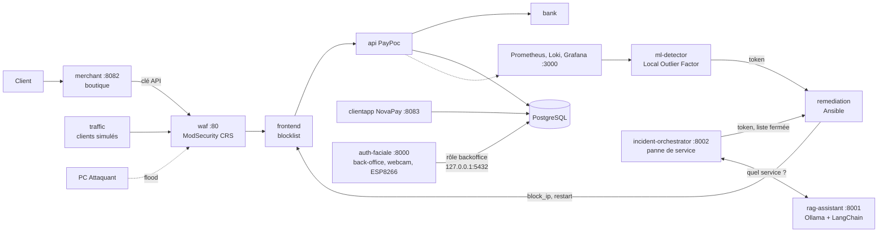

# PROJECT RESILIENCE-ALPHA, groupe 10

Démonstrateur de cyber-résilience d'une plateforme de paiement fictive (workshop M2 EPSI 2026-27) : une attaque est détectée par ML, remédiée par Ansible **sans intervention humaine**, et le retour du service est prouvé par une transaction. Aucune donnée bancaire réelle : cartes de test uniquement.

> **Examinateurs : installation et reproduction pas à pas sous Windows dans [GUIDE-WINDOWS.md](GUIDE-WINDOWS.md).** Un seul PC suffit, comptez 30 minutes du poste vierge à la preuve de reprise.

Contribuer (branches, commits, pull requests) : [CONTRIBUTING.md](CONTRIBUTING.md).

## Sommaire

1. [Arborescence](#arborescence)
2. [Architecture](#architecture)
3. [Prérequis](#prérequis)
4. [Démarrage](#démarrage)
5. [Interfaces et comptes de test](#interfaces-et-comptes-de-test)
6. [Recette et démo](#recette-et-démo)
7. [Secrets](#secrets)

## Arborescence

| Chemin | Contenu | Exécution |
|---|---|---|
| [`poc-resilience/`](poc-resilience/README.md) | **Le SI de démonstration** : boutique, passerelle PayPoc, banque fictive, NovaPay, WAF, observabilité, détection ML, remédiation, clients simulés | Docker Compose (`compose.yaml`) |
| [`auth-faciale/`](auth-faciale/README.md) | **Back-office** du SI (consigne additionnelle 1) : identifiant, visage par webcam USB, mot de passe, habilitations, LED ESP8266 | Python sur le PC Hôte, hors conteneur (webcam) |
| [`attacker/`](attacker/README.md) | **Red Team** : saturation HTTP du WAF depuis le PC Attaquant, avec garde-fou de périmètre | Docker ou Podman, sur le PC Attaquant |
| [`rag-assistant/`](rag-assistant/README.md) | **Assistant IA des opérateurs** : RAG local (Ollama + LangChain) sur la documentation de l'équipe | Python sur le PC Hôte, :8001 |
| [`incident-orchestrator/`](incident-orchestrator/README.md) | **Orchestrateur d'incident** : panne de service détectée, le LLM choisit le service à relancer dans une liste fermée, timeline live | Python sur le PC Hôte, :8002 |
| [`ml-lab/`](ml-lab/README.md) | Labo ML autonome sur logs simulés (deux Isolation Forest, calibration, évaluation) | Python, indépendant du POC |
| [`docs/`](docs/) | Déroulé de la démo ([`demo-jour-j.md`](docs/demo-jour-j.md)), schémas d'architecture et de base (`bdd-workshop-obsolete.png` : ancien modèle, gardé pour l'historique) | |
| [`scripts/init_env.py`](scripts/init_env.py) | Génère les `.env` et leurs secrets aléatoires (`just env`) | Python 3.12 |
| [`justfile`](justfile) | Toutes les commandes du projet : `just` les liste | [just](https://github.com/casey/just) |
| [`GUIDE-WINDOWS.md`](GUIDE-WINDOWS.md) | Reproduction complète sous Windows, commande par commande | |

## Architecture



Détail des services, des réseaux et de la boucle de résilience : [poc-resilience/README.md](poc-resilience/README.md) et [poc-resilience/docs/architecture.md](poc-resilience/docs/architecture.md).

## Prérequis

| Outil | PC Hôte Windows (démo) | Linux (développement) |
|---|---|---|
| Docker | Docker Desktop (WSL2) | Docker Engine, ou Podman avec `podman-compose` |
| just | `winget install Casey.Just` | paquet `just` ou `cargo install just` |
| Python 3.12 (configuration, back-office, assistant) | `py -3.12` | `uv` ou `python3` |
| Git for Windows (bash du smoke test, des sauvegardes) | oui | |
| Ollama (assistant, orchestrateur) | facultatif | facultatif |
| Webcam USB, carte ESP8266 | branchées sur le PC Hôte, facultatives | |

Installation de chaque outil sous Windows : [GUIDE-WINDOWS.md](GUIDE-WINDOWS.md#2-installer-les-outils).

## Démarrage

Sous Windows, suivre [GUIDE-WINDOWS.md](GUIDE-WINDOWS.md), qui détaille chaque commande et le résultat attendu. En résumé :

```powershell
just env                 # crée les .env et génère tous les secrets (affiche le mot de passe Grafana)
just demo-prep           # construit, démarre, attend les 20 conteneurs sains et le détecteur entraîné
just smoke               # vérifie paiement, WAF et observabilité
just demo                # paiement, attaque, détection, blocage automatique, paiement
just backoffice-install  # une fois : environnement Python du back-office
just backoffice          # back-office sur http://127.0.0.1:8000 (premier admin créé par la page /setup)
```

`just env` ne remplace jamais une valeur déjà remplie, et donne la même valeur à `BACKOFFICE_DB_PASSWORD` dans `poc-resilience/.env` et `auth-faciale/.env`. Sur une base créée avant le 21/10, `just db-init` ajoute le rôle `backoffice` et la clé marchand. Les autres recettes : `just down`, `just ps`, `just logs api waf`, `just reset` (supprime les volumes, avec confirmation), `just urls`.

Avec Podman : `just compose="podman-compose -f compose.podman.yaml" up`, où `compose.podman.yaml` est une variante locale non versionnée (WAF sur 8080, socket Podman).

## Interfaces et comptes de test

| Interface | Adresse | Identifiants |
|---|---|---|
| Boutique Brûlerie du Comptoir | http://localhost:8082 | achat invité, ou compte client Alice / Bob |
| NovaPay (espace client, validation 3DS) | http://localhost:8083 | `alice@example.com` / `Alice_Test_2026!`, `bob@example.com` / `Bob_Test_2026!` |
| Back-office (visage + mot de passe) | http://127.0.0.1:8000 | premier admin par la page `/setup`, les autres dans les habilitations |
| Assistant RAG | http://127.0.0.1:8001 | aucun, local uniquement |
| Timeline des incidents (orchestrateur) | http://127.0.0.1:8002 | aucun, local uniquement |
| Grafana (dossier *Resilience-Alpha*) | http://localhost:3000 | `admin` / `GRAFANA_ADMIN_PASSWORD` du `.env` |
| pgAdmin | http://localhost:5050 | `PGADMIN_EMAIL` / `PGADMIN_PASSWORD` du `.env` |
| Prometheus | http://localhost:9090 | aucun, local uniquement |
| API Comptes (Swagger) | http://localhost:8081/docs | aucun |

Cartes de test : `5555 5555 5555 4444` approuvée directement, `4242 4242 4242 4242` (carte d'Alice) passe par la validation 3DS dans NovaPay, `4000 0000 0000 0002` refusée. Liste complète dans [poc-resilience/README.md](poc-resilience/README.md#cartes-de-test).

## Recette et démo

| Preuve | Commande |
|---|---|
| Chaîne de paiement, WAF, observabilité | `just smoke` |
| Stack prête pour la démo : conteneurs sains, détecteur entraîné | `just demo-prep` |
| Boucle autonome : paiement, flood, détection ML, blocage de l'attaquant, paiement | `just demo`, après `just demo-prep` |
| Rejouer l'attaque sans attendre la fin du blocage (5 min) | `just attack-reset` |
| Attaque depuis le PC Attaquant | `just attack-check`, puis `just attack` ([attacker/README.md](attacker/README.md)) |
| Panne de service, reprise décidée par le LLM | `just assistant`, `just orchestrator`, puis `just chaos` ([incident-orchestrator/README.md](incident-orchestrator/README.md)) |
| Sauvegarde et restauration vérifiée de la base (PRA) | `just backup`, puis `just restore-check` |
| Authentification du back-office | [auth-faciale/docs/recette.md](auth-faciale/docs/recette.md) |

Pendant la démo : Grafana, dashboard **07 · Résilience**, et `just logs ml-detector remediation`.

Le service `traffic` simule des clients pour que le détecteur apprenne une normale : ses paiements portent `origin="simulated"` et ses transactions sont préfixées `[SIM]`. Les dashboards 00 et 01 n'affichent que les paiements clients par défaut (variable **Origine des paiements**).

Déroulé du jour J, minute par minute, et plan B : [docs/demo-jour-j.md](docs/demo-jour-j.md).

## Secrets

Aucun secret n'est versionné en clair. Les valeurs réelles vivent dans `poc-resilience/.env`, `auth-faciale/.env` et `auth-faciale/esp8266/include/secrets.h`, tous ignorés par Git. Les fichiers `*.example` ne contiennent que des valeurs `change-me`, que `just env` remplace par des secrets aléatoires.

Les secrets de l'équipe sont aussi versionnés **chiffrés** avec SOPS + age (`poc-resilience/secrets/poc-resilience.enc.env`, `auth-faciale/secrets/auth-faciale.enc.env`), déchiffrables par les seules clés publiques listées dans [`.sops.yaml`](.sops.yaml). Procédure : [poc-resilience/secrets/README.md](poc-resilience/secrets/README.md). Une installation neuve n'en a pas besoin : `just env` génère ses propres secrets.

Les comptes Alice et Bob et les cartes de test sont fictifs et documentés volontairement.
