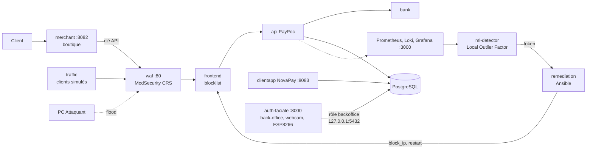

# PROJECT RESILIENCE-ALPHA, groupe 10

Démonstrateur de cyber-résilience d'une plateforme de paiement fictive (workshop M2 EPSI 2026-27) : une attaque est détectée par ML, remédiée par Ansible **sans intervention humaine**, et le retour du service est prouvé par une transaction. Aucune donnée bancaire réelle : cartes de test uniquement.

Contribuer (branches, commits, pull requests) : [CONTRIBUTING.md](CONTRIBUTING.md).

## Sommaire

1. [Arborescence](#arborescence)
2. [Architecture](#architecture)
3. [Prérequis](#prérequis)
4. [Démarrage](#démarrage)
5. [Interfaces et comptes de test](#interfaces-et-comptes-de-test)
6. [Recette et démo](#recette-et-démo)
7. [Secrets](#secrets)

## Arborescence

| Chemin | Contenu | Exécution |
|---|---|---|
| [`poc-resilience/`](poc-resilience/README.md) | **Le SI de démonstration** : boutique, passerelle PayPoc, banque fictive, NovaPay, WAF, observabilité, détection ML, remédiation, clients simulés | Docker Compose (`compose.yaml`) |
| [`auth-faciale/`](auth-faciale/README.md) | **Back-office** du SI (consigne additionnelle 1) : identifiant, visage par webcam USB, mot de passe, habilitations, LED ESP8266 | Python sur le PC Hôte, hors conteneur (webcam) |
| [`ml-lab/`](ml-lab/README.md) | Labo ML autonome sur logs simulés (deux Isolation Forest, calibration, évaluation) | Python, indépendant du POC |
| [`docs/schemas/`](docs/schemas/) | Schémas d'architecture et de base (`bdd-workshop-obsolete.png` : ancien modèle, gardé pour l'historique) | |
| [`justfile`](justfile) | Toutes les commandes du projet : `just` les liste | [just](https://github.com/casey/just) |

## Architecture



Détail des services, des réseaux et de la boucle de résilience : [poc-resilience/README.md](poc-resilience/README.md) et [poc-resilience/docs/architecture.md](poc-resilience/docs/architecture.md).

## Prérequis

| Outil | PC Hôte Windows (démo) | Linux (développement) |
|---|---|---|
| Docker | Docker Desktop (WSL2) | Docker Engine, ou Podman avec `podman-compose` |
| just | `winget install Casey.Just` | paquet `just` ou `cargo install just` |
| Python 3.12 (back-office) | `py -3.12` | `uv` ou `python3` |
| Git for Windows (bash du smoke test) | oui | |
| Webcam USB, carte ESP8266 | branchées sur le PC Hôte | |

## Démarrage

```bash
just env                 # crée les .env depuis les modèles : remplacer chaque change-me
just up                  # construit et démarre la stack (environ 2 min au premier lancement)
just smoke               # vérifie paiement, WAF et observabilité
just backoffice-install  # une fois : environnement Python du back-office
just user pablo admin    # une fois : premier admin, enrôlement du visage (back-office arrêté)
just backoffice          # lance le back-office sur http://127.0.0.1:8000
```

`BACKOFFICE_DB_PASSWORD` doit être identique dans `poc-resilience/.env` et `auth-faciale/.env`. Sur une base créée avant le 21/10, `just db-init` ajoute le rôle `backoffice` et la clé marchand. Les autres recettes : `just down`, `just ps`, `just logs api waf`, `just reset` (supprime les volumes, avec confirmation), `just urls`.

Avec Podman : `just compose="podman-compose -f compose.podman.yaml" up`, où `compose.podman.yaml` est une variante locale non versionnée (WAF sur 8080, socket Podman).

## Interfaces et comptes de test

| Interface | Adresse | Identifiants |
|---|---|---|
| Boutique Brûlerie du Comptoir | http://localhost:8082 | achat invité, ou compte client Alice / Bob |
| NovaPay (espace client, validation 3DS) | http://localhost:8083 | `alice@example.com` / `Alice_Test_2026!`, `bob@example.com` / `Bob_Test_2026!` |
| Back-office (visage + mot de passe) | http://127.0.0.1:8000 | comptes créés par `just user`, habilitations dans le back-office |
| Grafana (dossier *Resilience-Alpha*) | http://localhost:3000 | `admin` / `GRAFANA_ADMIN_PASSWORD` du `.env` |
| pgAdmin | http://localhost:5050 | `PGADMIN_EMAIL` / `PGADMIN_PASSWORD` du `.env` |
| Prometheus | http://localhost:9090 | aucun, local uniquement |
| API Comptes (Swagger) | http://localhost:8081/docs | aucun |

Cartes de test : `5555 5555 5555 4444` approuvée directement, `4242 4242 4242 4242` (carte d'Alice) passe par la validation 3DS dans NovaPay, `4000 0000 0000 0002` refusée. Liste complète dans [poc-resilience/README.md](poc-resilience/README.md#cartes-de-test).

## Recette et démo

| Preuve | Commande |
|---|---|
| Chaîne de paiement, WAF, observabilité | `just smoke` |
| Stack prête pour la démo : conteneurs sains, détecteur entraîné | `just demo-prep` |
| Boucle autonome : paiement, flood, détection ML, blocage de l'attaquant, paiement | `just demo`, après `just demo-prep` |
| Authentification du back-office | [auth-faciale/docs/recette.md](auth-faciale/docs/recette.md) |

Pendant la démo : Grafana, dashboard **07 · Résilience**, et `just logs ml-detector remediation`.

Le service `traffic` simule des clients pour que le détecteur apprenne une normale : ses paiements portent `origin="simulated"` et ses transactions sont préfixées `[SIM]`. Les dashboards 00 et 01 n'affichent que les paiements clients par défaut (variable **Origine des paiements**).

Déroulé du jour J, minute par minute, et plan B : [docs/demo-jour-j.md](docs/demo-jour-j.md).

## Secrets

Aucun secret n'est versionné : les valeurs réelles vivent dans `poc-resilience/.env`, `auth-faciale/.env` et `auth-faciale/esp8266/include/secrets.h`, tous ignorés par Git. Les fichiers `*.example` ne contiennent que des valeurs à remplacer. Les comptes Alice et Bob et les cartes de test sont fictifs et documentés volontairement.
