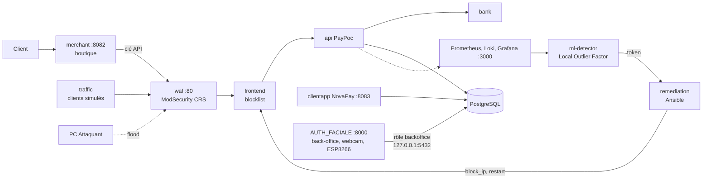

# PROJECT RESILIENCE-ALPHA, groupe 10

Démonstrateur de cyber-résilience d'une plateforme de paiement fictive (workshop M2 EPSI 2026-27) : attaque, détection par ML, remédiation Ansible **sans intervention humaine**, service rétabli et prouvé par une transaction. Aucune donnée bancaire réelle : cartes de test uniquement.

Pour contribuer (branches, commits, pull requests) : [CONTRIBUTING.md](CONTRIBUTING.md).

## Le dépôt

| Dossier | Contenu | Lancement |
|---|---|---|
| [`poc-resilience/`](poc-resilience/README.md) | **Le SI de démonstration** : boutique, passerelle PayPoc, banque fictive, NovaPay, WAF, observabilité, ML, remédiation, clients simulés | Docker Compose |
| [`AUTH_FACIALE/`](AUTH_FACIALE/README.md) | **Back-office** du SI (consigne additionnelle 1) : identifiant, visage par webcam USB, mot de passe, habilitations, LED ESP8266 | Python sur le PC Hôte, hors conteneur (webcam) |
| [`ML/`](ML/README.md) | Labo ML autonome sur logs simulés (deux Isolation Forest, calibration, évaluation) | Python, indépendant du POC |
| `SCHEMA/` | Schémas d'architecture et de base | |

## Ce qui tourne, et comment c'est relié



## Démarrer le PC Hôte

1. **Le SI** (Docker Desktop sous Windows, ou Docker sous Linux) :

   ```bash
   cd poc-resilience
   cp .env.example .env        # remplacer toutes les valeurs change-me
   docker compose up -d --build
   ./scripts/smoke-test.sh
   ```

2. **Le back-office**, dans un second terminal : voir [AUTH_FACIALE/LANCEMENT.md](AUTH_FACIALE/LANCEMENT.md). Il se connecte à la base du SI avec le mot de passe `BACKOFFICE_DB_PASSWORD` du `.env` de `poc-resilience`.

3. **La démo de résilience**, environ 2 minutes après le démarrage (apprentissage du détecteur) :

   ```powershell
   ./scripts/demo-incident.ps1
   ```

| Interface | Adresse |
|---|---|
| Boutique | http://localhost:8082 |
| NovaPay (espace client) | http://localhost:8083 |
| Back-office (visage + mot de passe) | http://127.0.0.1:8000 |
| Grafana | http://localhost:3000 |
| pgAdmin | http://localhost:5050 |

## Recette

| Preuve | Commande |
|---|---|
| Chaîne de paiement, WAF, observabilité | `poc-resilience/scripts/smoke-test.sh` |
| Boucle autonome flood, détection, blocage, paiement après | `poc-resilience/scripts/demo-incident.ps1` (Windows) ou `.sh` (Linux) |
| Authentification du back-office | [AUTH_FACIALE/RECETTE.md](AUTH_FACIALE/RECETTE.md) |

## Secrets

Aucun secret n'est versionné : les valeurs réelles vivent dans `poc-resilience/.env`, `AUTH_FACIALE/.env` et `AUTH_FACIALE/esp8266/include/secrets.h`, tous ignorés par Git. Les fichiers `*.example` ne contiennent que des valeurs à remplacer.
